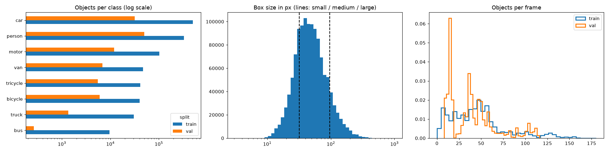
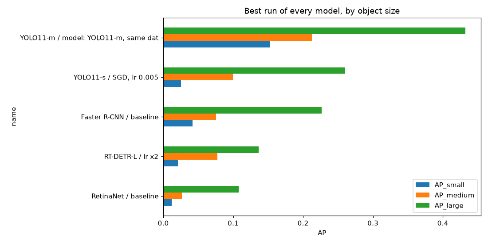
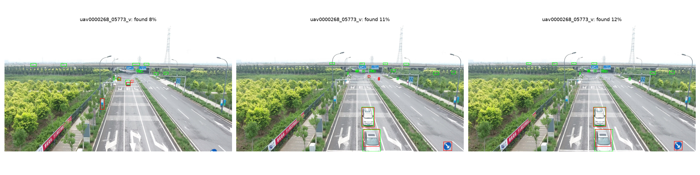
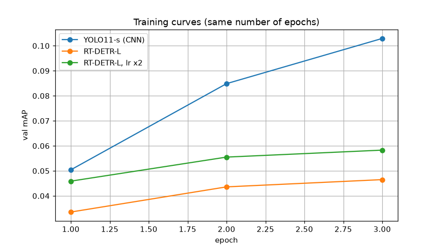
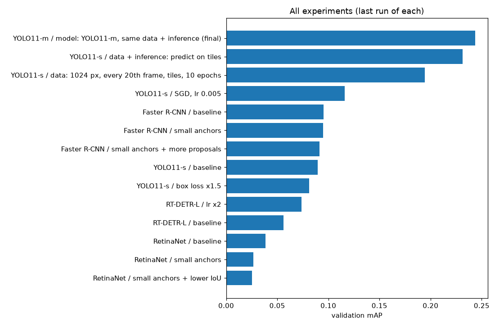

## 1. Task

We find objects on frames of drone videos (VisDrone2019-VID). For every object we give a box, a class and a score. There are 8 classes. The main metric is COCO mAP. All code is in `notebooks/`. Every section says which notebook gives the numbers.

## 2. Data and preprocessing

### 2.1 What the data looks like (notebook 01)

| | train | val | test |
|---|---|---|---|
| clips | 56 | 7 | 48 |
| frames | 24 201 | 2 846 | 3 811 |
| objects | 1 105 516 | 114 132 | - |
| ignored regions | 510 744 | 31 960 | - |



What we saw:

* **Classes are not balanced.** Cars are 44 % of the objects. Buses are only 0.8 % (50 times fewer). The model will learn rare classes worse.
* **Objects are small.** The median box is 46 px. 24 % of the boxes are smaller than 32 px. The frames are big (up to 3840 px). At 640 px a 46 px car becomes about 11 px. So we need a bigger input or crops.
* **Scenes are dense:** 43 objects per frame in the middle, up to 180. We keep up to 500 boxes per frame.
* **Clips are very different:** from 5 to 143 objects per frame.
* **There are many ignored regions** (crowds, parking lots).
* No clip is in train and val at the same time.

### 2.2 Preprocessing (notebook 02)

* **Split by clip.** Frames of one clip look almost the same. A split by frame would give a too high score. Train and val are already different clips.
* **Every N-th frame.** Frames next to each other are almost the same. We take every 100th frame for the model comparison (a few minutes per run). We take every 20th frame for the final model.
* **Ignored regions** are painted gray in training images. Without this the model learns that crowds are background.
* **Resize** one time before training: 640 px or 1024 px.
* **Tiles.** In the final dataset every frame also gives 4 crops. In a crop the objects are about 1.7 times bigger.
* **Labels** are converted to the YOLO format. We drew them back on an image to check them (`images/02_label_check.png`).
* **Normalization and augmentation** happen during training: flip and colour changes (plus mosaic and scale for YOLO).

### 2.3 Validation

Every model is scored on the same **146 val frames** (every 20th frame of each val clip) with the COCO metric (pycocotools). Ignored regions have `iscrowd = 1`. So boxes there are not errors. We also measure the speed (ms per image).

## 3. Model comparison (same short budget)

All models start from COCO weights. Same settings: 640 px, every 100th frame, 3 epochs, the same seed.

| model | type | best experiment | mAP | AP_small | ms/img |
|---|---|---|---|---|---|
| Faster R-CNN | two-stage, anchors | baseline | 0.095 | 0.042 | 213 |
| RetinaNet | one-stage, anchors | baseline | 0.038 | 0.012 | 169 |
| YOLO11-s | one-stage, no anchors | SGD, lr 0.005 | 0.116 | 0.025 | 124 |
| RT-DETR-L | query-based | lr 0.0002 | 0.074 | 0.021 | 157 |



**Noise.** The same YOLO baseline gave 0.116 and 0.090 in two runs. With 3 epochs small differences are only noise.

### 3.1 Faster R-CNN (notebook 03)

Faster R-CNN works in two steps. The **RPN** checks anchors on the whole image. It keeps about 2000 places where an object can be. The **second stage** looks at every place again. It says the class and makes the box more exact. If the RPN misses an object, the second stage cannot find it.

We tried smaller anchors (from 16 px) and more proposals (4000). The mAP was almost the same: 0.095, 0.095 and 0.092. AP_small was a little better (0.042 → 0.044). But more proposals made the model 40 % slower.



The 3 worst frames come from one clip. The camera is high and looks far. The model found only 8-11 % of the objects:

1. **Tiny cars far away** near the horizon. At 640 px they are only a few pixels.
2. **Cars in a dense line** on the bridge. Their boxes overlap. NMS removes some real objects.
3. **A road sign** gets a box. It has a box shape and strong colours, like a small car from above.

### 3.2 RetinaNet (notebook 04)

RetinaNet has no proposal step. It checks about 100 000 anchors at once. Almost all of them are background. **Focal loss** gives a very small loss to easy background anchors. So the model learns from the hard ones.

RetinaNet was the weakest model: 0.038 mAP (2.5 times worse than Faster R-CNN). Our changes made it worse: smaller anchors gave 0.026, lower IoU thresholds (0.4 / 0.3) gave 0.025. We think the pretrained head learned the default anchor sizes. 3 epochs are not enough to learn new ones. Lower thresholds also give bad positive examples. Without a second stage the boxes are less exact (AP50 0.08 vs 0.22). More epochs or a better anchor assignment (ATSS) should help.

### 3.3 YOLO11-s (notebook 05)

YOLO has no anchors. The image is a grid of points (one point every 8, 16 or 32 px). For every object YOLO takes the points inside its box. It picks the 10 best points by class score and box overlap (task-aligned assignment). A small object covers only 1-2 points. Two close objects want the same points. So one of them can be lost.

Search range: box loss weight 7.5 or 11.25, optimizer auto or SGD (lr 0.005). A bigger box weight was worse (0.081). **SGD with lr 0.005 was the best** (0.116).

YOLO had the best mAP and was the fastest model (124 ms). It is better on medium and large objects. Faster R-CNN is better on small objects (0.042 vs 0.025). Its finest level has one point every 4 px.

### 3.4 RT-DETR-L (notebook 06)

RT-DETR is a transformer with 300 queries. In training every true object gets **exactly one** query (bipartite matching). So the model gives one box per object. We do not need NMS. At the start the matching changes a lot. So transformers learn slower than CNNs.

**Unsuccessful first try:** mAP = 0 for both learning rates. The reason: in the warm-up Ultralytics uses lr 0.1 for the bias. For a transformer with AdamW (lr 0.0001) it is 1000 times too big. It broke the COCO weights. With `warmup_bias_lr = 0` the model learned: 0.056 (lr 0.0001) and 0.074 (lr 0.0002).



In 3 epochs YOLO grows from 0.05 to 0.10. RT-DETR grows slowly and its curve still goes up. So RT-DETR **did not converge** in our budget. It is also weaker on small objects (0.021 vs 0.028). Attention works on small feature maps. There a small object is only one point.

## 4. Final pipeline (notebook 07)

YOLO was the best and the fastest, so the final pipeline uses YOLO11. We changed one thing at a time:

| step | change | mAP | AP_small | ms/img |
|---|---|---|---|---|
| 1 | YOLO11-s baseline (640 px, 3 epochs) | 0.090 | 0.028 | 172 |
| 2 | data: 1024 px, every 20th frame, tiles, 10 epochs | 0.194 | 0.117 | 119 |
| 3 | inference: also predict on tiles | 0.231 | 0.189 | 316 |
| 4 | model: YOLO11-m (final) | **0.244** | 0.152 | 349 |



* **Data helped the most:** +0.105 mAP, 4 times better AP_small. A bigger input with tiles makes small objects bigger. This step also has more frames and epochs.
* **Inference on tiles:** +0.037 mAP with no new training. But prediction is 2.7 times slower.
* **A bigger model:** only +0.012 mAP. It is better on large objects but worse on small ones. Training takes 2 times longer (155 → 313 min).
* So the data and the inference matter more than the model size.

**Kaggle public scores**

| submission | public score |
|---|---|
| YOLO11-s, 1024 px, every 20th frame, 10 epochs | 0.22 |
| YOLO11-m, 1024 px, tiles, 10 epochs | **0.31** |
| YOLO11-m, 1024 px, tiles, 15 epochs | 0.28 |

15 epochs gave a lower score than 10 epochs, so we keep 10.

## 5. Final model and how to run

**Final model:** YOLO11-m (COCO weights), 1024 px, every 20th frame, ignored regions masked, training and prediction on full frames + 4 tiles (NMS IoU 0.6), 10 epochs, batch 2 (GTX 1660 Ti) or 4 (T4), seed 36.

**Requirements:** Python 3.12, PyTorch 2.14 with CUDA, ultralytics 8.4.205, pycocotools, pandas, numpy, matplotlib, pillow, kaggle.

```
pip install torch torchvision --index-url https://download.pytorch.org/whl/cu126
pip install ultralytics==8.4.205 pycocotools pandas matplotlib pillow kaggle
```

**Steps:** run the notebooks in `notebooks/` in order.

1. `01_eda` downloads the data with the Kaggle API (if missing) and explores it.
2. `02_prepare_data` makes the training folders and the val frame list.
3. `03`-`06` compare the four detector types.
4. `07_final_pipeline` trains the final model and writes `submission_final_yolo11m_1024_tiles.csv`.

Data: `D:/hw2/data` (Windows) or `/content/data` (Colab). Results: `notebooks/experiments.csv`. Figures: `images/`.

## 6. References

* VisDrone dataset: Zhu et al., *Detection and Tracking Meet Drones Challenge*, 2020.
* Faster R-CNN: Ren et al., 2015. FPN: Lin et al., 2017. torchvision implementation.
* RetinaNet and focal loss: Lin et al., 2017. torchvision implementation.
* YOLO11 and RT-DETR: Ultralytics (docs.ultralytics.com). RT-DETR: Zhao et al., 2023.
* COCO metric: pycocotools.
* Lecture notebook *CV_Detection* (training loop, augmentation, metrics).
* The code was written with the help of an AI assistant (Claude).